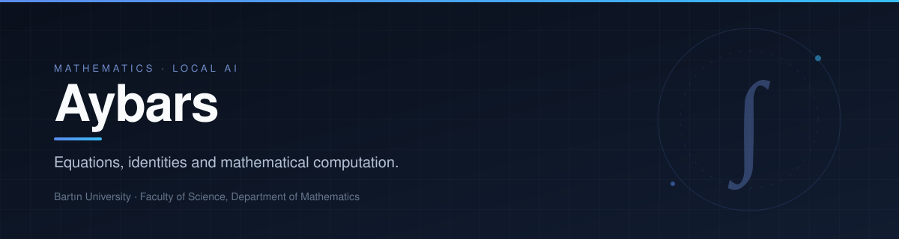

  

## About Me

I am a final-year undergraduate student in the Department of Mathematics, Faculty of Science, at Bartın University. My academic interests center on equations and identities, together with the methods used to solve and prove them. I translate these interests into software projects that run locally and produce verifiable computational results.

I develop desktop and Android applications, including multimodal AI workspaces, offline scientific calculators, voice assistants and IPTV players. The guiding principle behind these projects is local-first computation: wherever possible, processing takes place on the user's own hardware, computed results can be verified, and network access is confined to features that explicitly require it.

## Education

**Bartın University** — Faculty of Science, Department of Mathematics · BSc in Mathematics, final year

## Areas of Focus

| Equations and identities | Local AI | Application development |
| :--- | :--- | :--- |
| Equation and inequality solving, systems of equations, identity proofs, mathematical computation and verification | Large language models, speech-to-text and text-to-speech, optical character recognition (OCR), image and video generation — all running locally on the user's own hardware | Consistent, production-grade applications for Windows, Linux, macOS and Android |

## Selected Projects

### [MamidLabs](https://github.com/workaybarsh/MamidLabsTR)

A local-first multimodal AI workspace for chat, document reading and generation, OCR, audio transcription, image and video generation, and photo editing. A stable release is available for Windows; the two experimental ports, for Linux and macOS, offer the same feature set.

`Python` · `PowerShell` · `Qt 6` · `llama.cpp` · `ComfyUI`

### [Scientific Calculator](https://github.com/workaybarsh/ScientificCalculator)

An offline scientific calculator with 12 calculation modes, including symbolic differentiation and integration, equation and inequality solving, matrix–vector operations, statistical analysis and probability distributions. It employs a deliberately restricted expression parser and a SymPy-based computation engine. The Android edition is built with Kotlin and Jetpack Compose.

`Python` · `SymPy` · `Tk` · `Kotlin` · `Jetpack Compose`

### [Altai](https://github.com/workaybarsh/altai)

A fully local voice chat assistant for Windows. It transcribes speech with whisper.cpp, generates responses with a Qwen3.5 9B model using multi-token prediction (MTP), and reads them aloud with Piper. The design target is to begin audio output within one second after the user stops speaking.

`Python` · `PowerShell` · `whisper.cpp` · `llama.cpp` · `Piper`

### [ZeltaTV](https://github.com/workaybarsh/zeltatv)

A television-first IPTV player designed for remote-control navigation. It supports M3U/M3U8 playlists and includes a channel library, favorites and an interface localized into 18 languages. It is the desktop edition of ZeltaTV; the Android TV, phone and tablet editions are maintained in a separate repository and built with Kotlin, Jetpack Compose and Media3.

`SvelteKit` · `Electron` · `HLS.js` · `Kotlin` · `Media3`

## Additional Projects

- **[AFK Game Downloader Pro](https://github.com/workaybarsh/afk-game-downloader-pro)** — Monitors Steam and Epic Games downloads and shuts down the PC only once the selected downloads are verifiably complete.
- **[Kelam](https://github.com/workaybarsh/kelam)** — Connects the microphone button on a remote control to Windows voice typing, so that dictated text appears in any application.
- **[GPU Clock Tools](https://github.com/workaybarsh/gpu-clock-tools)** — Two independent, dependency-free Windows utilities for NVIDIA GPUs: a temperature-targeted clock tuner and a workload-aware clock watchdog.
- **[Automatic IPTV Channel List Updater](https://github.com/workaybarsh/automatic-iptv-channel-list-updater)** — Repairs broken M3U links using the iptv-org database while preserving channel order. ([Turkish version](https://github.com/workaybarsh/otomatik-iptv-kanal-listesi-guncelleme-araci))
- **[Yabaylar Okey Oynaylar](https://github.com/workaybarsh/Yabaylar-okey-oynaylar)** — A design-stage project for the Turkish tile game 101 Okey, with AI opponents and in-game chat.

## Technical Stack

**Languages**  

**Mathematics and scientific computing**  

**Local AI**  

**Interface and deployment**  

**Platforms and tooling**  

## Contact

For inquiries, suggestions and collaboration requests, please contact me on GitHub at **[@workaybarsh](https://github.com/workaybarsh)** or by email at **[work@aybarsh.com](mailto:work@aybarsh.com)**. Bug reports should be submitted through the **Issues** tab of the relevant repository.
