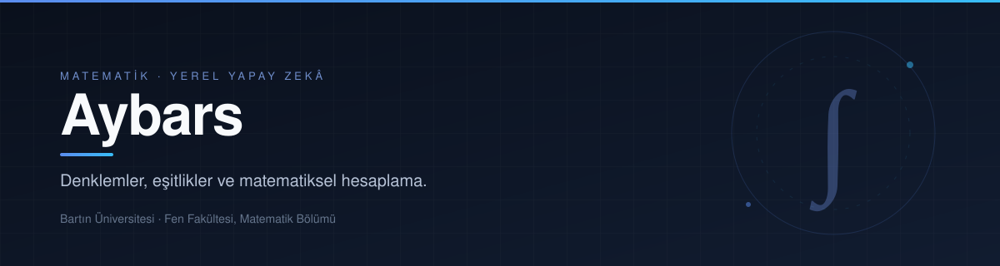

  

## Hakkımda

Bartın Üniversitesi Fen Fakültesi Matematik Bölümü'nde son sınıf öğrencisiyim. Akademik ilgi alanım özellikle **denklemler, eşitlikler ve bunların çözüm yöntemleridir**. Bu ilgiyi, tamamen yerel çalışan ve doğrulanabilir sonuç üreten yazılım projelerine dönüştürüyorum.

Masaüstü ve Android platformları için uygulamalar geliştiriyorum: çok modlu yapay zekâ çalışma alanları, çevrimdışı bilimsel hesap makineleri, sesli asistanlar ve IPTV oynatıcıları. Projelerimin ortak ilkesi, verinin cihaz dışına çıkmaması ve hesaplama sonuçlarının doğrulanabilir olmasıdır.

## Eğitim

**Bartın Üniversitesi** — Fen Fakültesi, Matematik Bölümü · Lisans, son sınıf

## Çalışma Alanları

| Denklemler ve eşitlikler | Yerel yapay zekâ | Uygulama geliştirme |
| :--- | :--- | :--- |
| Denklem ve eşitsizlik çözümü, denklem sistemleri, matematiksel hesaplama ve doğrulama | LLM, STT/TTS, OCR, görsel ve video üretimi — çevrimdışı, kullanıcının kendi donanımında | Windows, Linux, macOS ve Android için tutarlı, masaüstü kalitesinde araçlar |

## Öne Çıkan Projeler

### [MamidLabs](https://github.com/workaybarsh/MamidLabsTR)

Tamamen yerel çalışan çok modlu yapay zekâ çalışma alanı: sohbet, belge okuma ve üretimi, OCR, ses dökümü, görsel–video üretimi ve fotoğraf düzenleme. Windows için kararlı sürüm; Linux ve macOS portları aynı araç kümesini paylaşmaktadır.

`Python` · `PowerShell` · `Qt6` · `llama.cpp` · `ComfyUI`

### [ScientificCalculator](https://github.com/workaybarsh/ScientificCalculator)

On iki çalışma moduna sahip çevrimdışı bilimsel hesap makinesi: sembolik türev ve integral, denklem ve eşitsizlik çözümü, matris–vektör işlemleri, istatistik ve dağılımlar. Kısıtlı bir ifade ayrıştırıcı ve SymPy tabanlı hesaplama motoru kullanmaktadır. Android sürümü Kotlin ve Jetpack Compose ile geliştirilmiştir.

`Python` · `SymPy` · `Tk` · `Kotlin` · `Jetpack Compose`

### [Altai](https://github.com/workaybarsh/altai)

Windows için tamamen yerel sesli sohbet asistanı. whisper.cpp ile konuşmayı metne çevirmekte, Qwen 3.5 9B (MTP) ile yanıt üretmekte ve Piper ile seslendirmektedir. Hedef, kullanıcı konuşmayı bitirdikten sonra ilk sesin 1 saniyenin altında üretilmesidir.

`Python` · `PowerShell` · `whisper.cpp` · `llama.cpp` · `Piper`

### [ZeltaTV](https://github.com/workaybarsh/zeltatv)

Uzaktan kumanda odaklı, TV-first IPTV oynatıcı. M3U/M3U8 oynatma listeleri, kanal kütüphanesi, favoriler ve 18 dil desteği sunmaktadır. zeltatv projesinin masaüstü devamıdır; Android TV ve telefon portu Kotlin, Jetpack Compose ve Media3 ile ayrı bir depoda geliştirilmektedir.

`SvelteKit` · `Electron` · `HLS.js` · `Kotlin` · `Media3`

## Diğer Projeler

- **[MamidLabsENG](https://github.com/workaybarsh/MamidLabsENG)** — MamidLabs'in İngilizce sürümü.
- **[mamidlabs_linux](https://github.com/workaybarsh/mamidlabs_linux)** · **[mamidlabs_mac](https://github.com/workaybarsh/mamidlabs_mac)** — Linux ve macOS portları (Python + Qt6).
- **[ScientificCalculator-android](https://github.com/workaybarsh/ScientificCalculator-android)** — Aynı hesaplama motorunun Android sürümü.
- **[android](https://github.com/workaybarsh/android)** — ZeltaTV'nin Android TV ve telefon portu.
- **[Yabaylar-okey-oynaylar](https://github.com/workaybarsh/Yabaylar-okey-oynaylar)** — 101 Okey için yapay zekâ rakipler ve sohbet içeren tasarım çalışması.

## Teknolojiler

**Diller**  

**Matematik ve hesaplama**  

**Yerel yapay zekâ**  

**Arayüz ve platform**  

**Araçlar**  

## İletişim

Soru, öneri ve iş birliği talepleri için GitHub üzerinden iletişim kurulabilir: **[@workaybarsh](https://github.com/workaybarsh)**. Hata bildirimleri için ilgili deponun **Issues** sekmesi kullanılabilir.
